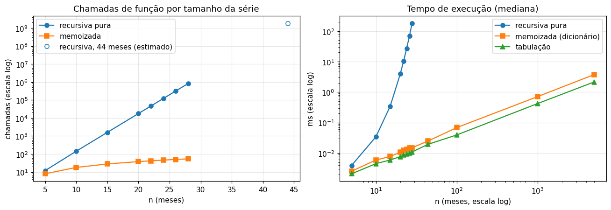
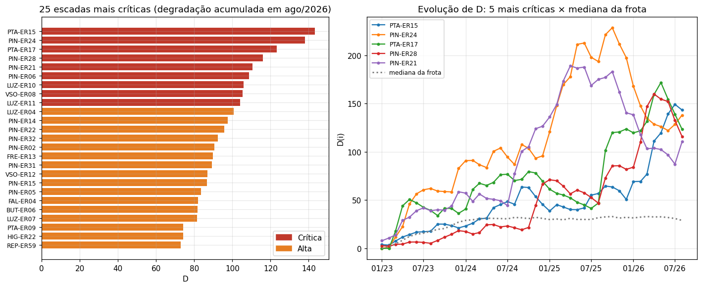
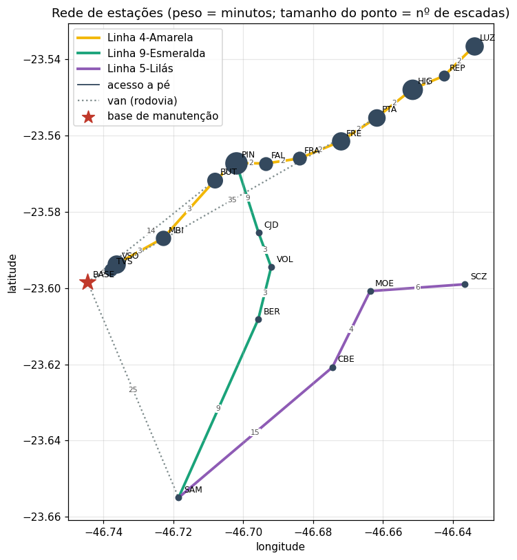
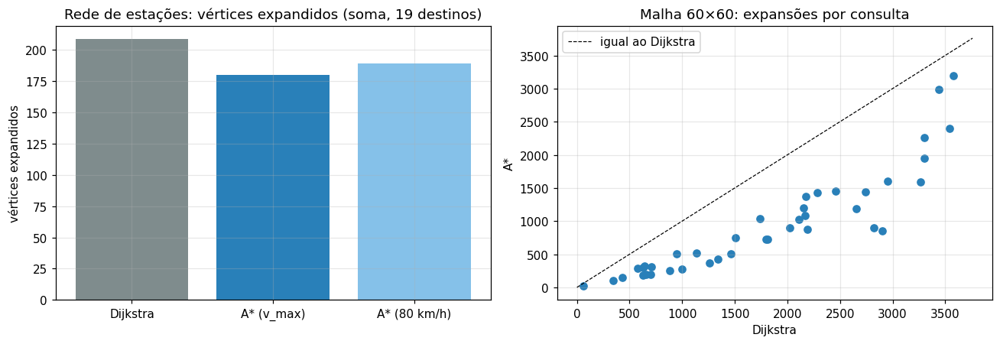

# SafeStair — Dynamic Programming

**Challenge Motiva + FIAP 2026/2027 · Engenharia de Software · Turma 2ESPR · Squad 6**

| Integrante | RM |
|---|---|
| Marcelo Checchia Pivello de Toledo | 538697 |
| Nícolas Miguel Bittencourt Tanajura | 568108 |
| Rafael Benez Martins | 574994 |

Camada algorítmica do **SafeStair**, aplicada ao **dataset real da Motiva**: o histórico de notas de manutenção (SAP) das escadas rolantes da Linha 4-Amarela, de 2009 a 2026. O repositório responde a três perguntas: **quais escadas merecem prioridade**, **qual o caminho mais rápido até elas** e **o que a equipe deve atender em um turno**.

O repositório tem **dois notebooks executados**, com os mesmos algoritmos e fontes de dados diferentes:

| Notebook | Dados | Papel |
|---|---|---|
| [`notebook.ipynb`](notebook.ipynb) | **Reais**: falhas do SAP da Motiva (2023–2026) | **Entrega principal**: diagnóstico da frota real |
| [`notebook_sensores.ipynb`](notebook_sensores.ipynb) | **Simulados**: leituras de sensores para as 197 escadas reais | Mostra que o modelo recebe a telemetria proposta pelo SafeStair, com os limites do DDD-Java |

As Partes 2 e 3 (grafo, BFS, Dijkstra, A*) são idênticas nos dois; mudam a origem da penalidade (Parte 1) e o tempo de serviço do plano (Parte 4). O restante deste README descreve o notebook principal; o resumo do de sensores está no final.

---

## Como executar

```bash
pip install -r requirements.txt
jupyter notebook notebook.ipynb            # Kernel > Restart & Run All (~30 s)
jupyter notebook notebook_sensores.ipynb   # idem (~20 s)

# opcional: regenerar os dados a partir das planilhas originais
# (copie ecr_2009.XLSX ... ecr_2026.XLSX para data/raw/)
python scripts/preparar_dados.py
python scripts/gerar_rede.py
```

## Estrutura

```
├── notebook.ipynb              # dados reais do SAP (entrega principal)
├── notebook_sensores.ipynb     # sensores simulados (complementar)
├── data/
│   ├── falhas.csv              # 27 200 falhas corretivas (Z1), 197 escadas, jan/2023–ago/2026
│   ├── escadas.csv             # cadastro: escada → estação → local SAP
│   ├── resumo_notas_ano.csv    # notas por tipo e ano (2009–2026)
│   ├── rede_estacoes.json      # 19 estações + 1 base, 22 trechos com peso em minutos
│   ├── sensores/leituras_sensores.csv   # 4 728 leituras simuladas (24 dias × 197 escadas)
│   └── raw/                    # planilhas originais ecr_AAAA.XLSX (não versionadas)
├── scripts/
│   ├── preparar_dados.py       # planilhas SAP → CSVs limpos
│   ├── gerar_rede.py           # gera a rede de estações
│   ├── gerar_sensores.py       # gera as leituras simuladas de sensores
│   ├── montar_notebooks.py     # monta os dois notebooks a partir de scripts/fonte/
│   └── fonte/                  # blocos de células (Parte 1 e 4 de cada notebook, Partes 2–3 compartilhadas)
├── figuras/
└── requirements.txt
```

## O dataset

Cada linha das planilhas é uma nota de manutenção do SAP. O campo **Local de Instalação** identifica a escada: `SP04-6-ECR-PIN-ER24` = Linha 4, escada rolante, Pinheiros, ER24.

| Tipo | O que representa | Uso |
|---|---|---|
| Z1 | Falha corretiva (escada parou ou deu alarme) | **base da análise** |
| Z2 | Anomalia sem parada (ruído, folga, óleo baixo) | não usado |
| Z3 | Preventiva programada (P1, P6…) | não usado |

**Decisões de limpeza** (em `scripts/preparar_dados.py`):
- **Recorte jan/2023 a ago/2026.** Em 2023 o volume de Z1 salta de cerca de 2 mil para mais de 7 mil por ano, porque cerca de 78% das falhas passam a ser abertas automaticamente pelo monitoramento (status OAUT). Misturar os dois regimes faria a frota inteira parecer piorar em 2023. O arquivo de 2009 é quase todo carga do plano preventivo.
- **Agosto/2026 é o último mês completo**: o arquivo de 2026 termina em 22/09.
- **Notas canceladas ou duplicadas** (status CANC/DUPL) foram excluídas.

Resultado: **27 200 falhas de 197 escadas em 12 locais**, o mesmo total de escadas da ViaQuatro informado pela Motiva.

---

## Parte 1 — Degradação acumulada e ranking de criticidade

### Penalidade

Cada falha vale:

$$\text{peso} = b \times f + \frac{\min(\text{horas parada},\,72)}{4}$$

- $b$ = 1 se a escada parou e 0,5 se não parou.
- $f$ = 1,5 se houve troca de peça (desgaste físico), 1 se não houve (resets, ajustes).
- Cada 4 horas de parada valem 1 ponto, com teto de 72 h por falha.

A penalidade do mês, $p_i$, é a soma dos pesos das falhas do mês: são 44 valores por escada.

### Recorrência

$$D(0) = p_0,\qquad D(1) = p_1 + \alpha D(0)$$
$$D(i) = p_i + \alpha\,D(i-1) + \beta\,\max\bigl(0,\ D(i-1) - D(i-2)\bigr)$$

- $\alpha = 0{,}85$ é a memória: após 12 meses resta cerca de 14%, então $D$ reflete principalmente o último ano.
- $\beta = 0{,}5$ é a aceleração: metade da piora recente é somada.

Como $D(i)$ depende de $D(i-1)$ e $D(i-2)$, a recursão pura recalcula subproblemas como Fibonacci.

### Três implementações e medição

| Função | Estratégia | Chamadas | Pilha |
|---|---|---|---|
| `degradacao_recursiva` | recursão pura | ≈ φⁿ | sim |
| `degradacao_memo` | recursão + dicionário | 2n − 2 | sim |
| `degradacao_tabulacao` | iterativa, bottom-up | — | não |



| Série | Chamadas (recursiva) | Chamadas (memo) |
|---|---:|---:|
| 24 meses, 197 escadas | 23 914 224 | 9 062 |
| 44 meses, por escada | 1 836 311 902 (estimado) | 86 |

**Interpretação.**
- As três versões dão **exatamente o mesmo resultado** nas 197 escadas (janela de 24 meses). Memoizada e tabulação também coincidem na série completa.
- A recursão pura cresce **2,618× a cada dois meses** (φ²). Na série real de 44 meses seriam 1,8 bilhão de chamadas por escada: cerca de 7 minutos por escada e quase um dia inteiro para a frota.
- A memoizada é linear, mas depende da pilha de recursão. A **tabulação** é linear, não usa pilha, devolve a série inteira e é a mais rápida em séries longas: **é a versão usada no ranking**.

### Ranking por criticidade

Criticidade = $D$ em ago/2026. As classes são definidas pela posição na frota:

| Classe | Posição | Escadas |
|---|---|---:|
| Crítica | 5% com maior $D$ | 9 |
| Alta | até 20% | 30 |
| Média | até 50% | 59 |
| Baixa | 50% restantes | 99 |

| # | Escada | Estação | D | Tendência (6 meses) | Falhas 12m | Horas parada 12m | Componente principal |
|---:|---|---|---:|---|---:|---:|---|
| 1 | PTA-ER15 | Paulista | 143,3 | piorando | 75 | 532 | placa pente móvel |
| 2 | PIN-ER24 | Pinheiros | 138,1 | estável | 129 | 386 | sensor de presença/velocidade |
| 3 | PTA-ER17 | Paulista | 123,4 | estável | 121 | 422 | pente da placa pente |
| 4 | PIN-ER28 | Pinheiros | 115,9 | estável | 132 | 286 | dispositivo de segurança |
| 5 | PIN-ER21 | Pinheiros | 110,4 | estável | 51 | 2 466 | relé térmico |
| 6 | PIN-ER06 | Pinheiros | 108,7 | piorando | 85 | 130 | rolete para degrau |
| 7 | LUZ-ER10 | Luz | 105,8 | piorando | 69 | 270 | rolete para degrau |
| 8 | VSO-ER08 | Vila Sônia | 105,3 | piorando | 133 | 245 | contato de segurança |
| 9 | LUZ-ER11 | Luz | 104,2 | piorando | 62 | 211 | sensor de presença |



**Interpretação.**
- **Onde está a degradação:** as críticas se concentram em Pinheiros (4), Paulista (2) e Luz (2), as estações de integração e de maior movimento.
- **A 1ª não é a que mais falha:** a PTA-ER15 tem 75 falhas em 12 meses, contra 129 da PIN-ER24. Ela lidera pelas 532 horas parada e porque está piorando. O gráfico mostra a PIN-ER24 em queda desde o pico do fim de 2025 e a PTA-ER15 subindo.
- **$D$ × contagem simples:** a correlação é alta (Spearman 0,89), mas o top 20 dos dois critérios só coincide em 14 escadas. A diferença está nas paradas longas. A PIN-ER15 é a 128ª em número de falhas, mas ficou 3 823 h parada (correntes do corrimão) e sobe para a 18ª posição pela degradação acumulada.
- **Prescrição:** o componente principal orienta a ordem de serviço. Rolete de degrau, sensores de presença e dispositivos de segurança se repetem entre as críticas.
- **Limites:** $D$ mede o histórico de falhas, não a condição física. Pesos, $\alpha$ e $\beta$ devem ser validados com a engenharia da Motiva. Sensores (vibração, temperatura, óleo) entrariam como novas parcelas da penalidade mensal, sem mudar o algoritmo.

---

## Parte 2 — Rede de estações como grafo

- **Vértices:** 11 estações da Linha 4 + Terminal Vila Sônia (os 12 locais com escadas no dataset), 7 estações das Linhas 9 e 5 e 1 base de manutenção no Pátio Vila Sônia.
- **Ids = códigos do SAP** (PTA, FRE, FAL, MBI, TVS…): cada uma das 197 escadas se liga a um vértice (verificado com `assert`).
- **Arestas:** 22 trechos com peso em minutos, incluindo 4 trechos de **van** a partir da base. Estrutura: lista de adjacência.



| Destino | Rota BFS (menos trechos) | min | Rota Dijkstra (menor tempo) | min |
|---|---|---:|---|---:|
| Paulista | BASE → PTA (van) | 35 | BASE → VSO → MBI → BUT → PIN → FAL → FRA → FRE → PTA | 22 |
| São Paulo-Morumbi | BASE → BUT → MBI | 17 | BASE → VSO → MBI | 9 |
| Santo Amaro | BASE → SAM (van) | 25 | BASE → SAM (van) | 25 |

**Interpretação.** Em **13 das 19 estações** o BFS escolhe uma rota mais lenta (9,4 min a mais em média, até 21 min). Ele prefere a van até a Paulista por ser um único trecho, mas são 35 minutos no trânsito, contra 22 de metrô. Entre caminhos com o mesmo número de trechos, o BFS fica com o primeiro que encontra, sem olhar o tempo. Para planejar a manutenção o critério correto é o tempo, então o plano usa Dijkstra.

---

## Parte 3 — A* com heurística justificada

$$h(n) = \frac{\text{haversine}(n,\text{destino})}{v_{\max}},\qquad v_{\max} = \max_{(a,b)\in E}\frac{\text{haversine}(a,b)}{\text{minutos}(a,b)} = 45{,}3\text{ km/h}$$

**Admissível e consistente:** todo trecho leva pelo menos dist/$v_{\max}$; pela desigualdade triangular, nenhum caminho até o destino é mais rápido que $h(n)$. O notebook verifica todos os pares de vértices e encontra **0 violações**.

| Cenário | Dijkstra | A* ($v_{\max}$) | A* (80 km/h) | Mesmo ótimo? |
|---|---:|---:|---:|---|
| Rede de estações, base → 19 destinos (expansões) | 209 | 180 (−14%) | 189 (−10%) | sim |
| Malha 60×60, 40 consultas (mediana de expansões) | 1 803 | 801 (−55%) | — | sim |



**Interpretação.** O A* sempre encontrou o mesmo tempo ótimo. Na rede de 20 vértices ele expande 14% menos, mas leva cerca do dobro de microssegundos, porque calcular a haversine custa mais que os poucos vértices economizados. Na malha de 3 600 vértices ele expande 55% menos e roda mais rápido. Para a rede atual, um Dijkstra a partir da base basta; o A* compensa com redes maiores e consultas ponto a ponto, como o replanejamento de um técnico em campo.

---

## Parte 4 — `planejar_turno(base, horas)`

**Regras:**
1. Entram as escadas de classe Crítica e Alta (39).
2. Nenhuma escada é atendida antes das que cabem da classe acima.
3. Dentro da classe, primeiro as outras escadas da estação onde a equipe já está (deslocamento zero), depois a de maior criticidade. O caminho é o de menor tempo (Dijkstra).
4. Só entra se deslocamento + serviço + retorno à base couberem no turno.
5. **Tempo de serviço vindo dos dados:** percentil 75 das paradas de cada escada nos últimos 12 meses, entre 30 e 240 min.

### Turno de 8 h (início 08:00)

| # | Escada | Componente | Rota | Chegada | Serviço | Término |
|---:|---|---|---|---|---:|---|
| 1 | PTA-ER15 | placa pente móvel | BASE → VSO → MBI → BUT → PIN → FAL → FRA → FRE → PTA | 08:22 | 230 min | 12:12 |
| 2 | PTA-ER17 | pente da placa pente | (mesma estação) | 12:12 | 51 min | 13:03 |
| 3 | PIN-ER24 | sensor de presença/velocidade | PTA → FRE → FRA → FAL → PIN | 13:11 | 76 min | 14:27 |
| 4 | PIN-ER28 | dispositivo de segurança | (mesma estação) | 14:27 | 68 min | 15:35 |

Retorno PIN → BUT → MBI → VSO → BASE (14 min), chegada às 15:49 · 98% do turno · 44 min de deslocamento e 425 min de serviço.

| Turno | 4 h | 6 h | 8 h | 10 h | 12 h |
|---|---:|---:|---:|---:|---:|
| Escadas atendidas | 3 | 2 | 4 | 5 | 5 |

**Interpretação.**
- O plano começa pela 1ª do ranking e agrupa as visitas por estação: duas escadas na Paulista, depois duas em Pinheiros.
- As rotas vêm do Dijkstra (metrô até a Paulista em 22 min, em vez de 35 de van).
- O tempo de serviço reflete cada escada: 230 min para a PTA-ER15, que costuma ficar parada muito tempo, contra 51 min para a PTA-ER17.
- **Prioridade × quantidade:** em 6 h a equipe atende menos escadas que em 4 h, porque passa a caber a PTA-ER15, que sozinha ocupa quase 4 horas. O plano prioriza criticidade, não quantidade.
- **Gargalo:** 9 escadas críticas com serviço mediano de 75 min não cabem em um turno. O dado indica duas equipes ou uma base avançada perto de Pinheiros e da Paulista.
- **Limites:** o algoritmo é guloso; o problema exato (*orienteering problem*) é NP-difícil. O tempo histórico de parada inclui a espera pelo técnico.

---

## Notebook complementar: sensores simulados

`notebook_sensores.ipynb` aplica os mesmos algoritmos a leituras diárias simuladas (01 a 24/09/2026) de vibração, temperatura, corrente, tensão, trepidação, nível de óleo e velocidade para as 197 escadas reais. Os perfis de falha são sorteados com semente fixa e **não têm relação com o histórico do SAP**, então a distribuição por estação não tem significado: o notebook demonstra o método.

- **Penalidade:** soma contínua da severidade de cada variável, com os mesmos limites do `ManutencaoService` (vibração 2,0/4,5 mm/s, temperatura 45/65 °C, óleo 80/40 %, trepidação 3,5/6,0 Hz) mais corrente, tensão e velocidade.
- **Três versões:** resultados idênticos; 24 milhões de chamadas da recursiva contra 9 062 da memoizada. Com telemetria horária (720 leituras/mês), só a tabulação é viável.
- **Ranking:** 17 críticas, todas também com "intervenção recomendada" no Java. 9 escadas que o Java considera normais aparecem como Alta, principalmente por queda de velocidade (atrito), variável que o Java ainda não usa: é a parte **preditiva**.
- **Plano de 8 h:** 4 críticas e 1 Alta, agrupadas em Higienópolis.

Os dois notebooks se complementam: os sensores dizem **qual** escada está degradando, e o histórico do SAP diz **quanto tempo** o reparo costuma levar.

---

## Ligação com as outras disciplinas

| Disciplina | Ligação |
|---|---|
| DDD-Java | O ranking e o componente principal são o "diagnóstico" que o `ManutencaoService` devolve; sensores entram como parcelas extras da penalidade. |
| Database Design | `falhas.csv` alimenta o histórico por escada; criticidade e classe podem ser gravadas junto a `T_SS_DIAGNOSTICO`. |
| Network | Os dados chegam ao servidor SafeStair pela rede projetada no Packet Tracer. |
| Agile | Atende RF04 (ranking e rotas), RF05 (`planejar_turno`) e RT02 (três versões do cálculo). |
